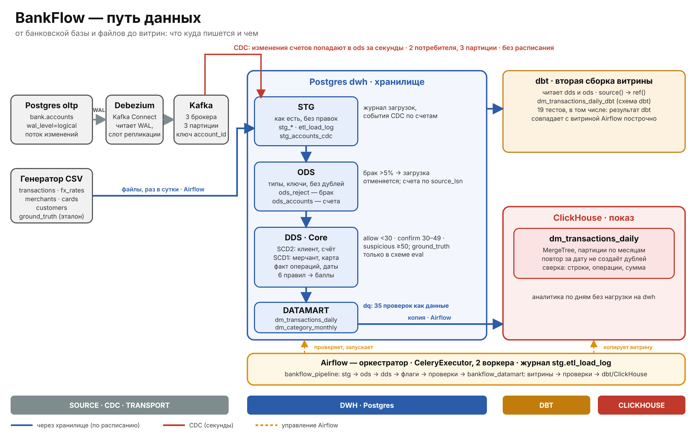

# BankFlow

Локальная платформа данных банка с CDC и антифродом. Поднимается на ноутбуке в Docker.



## Что делает

- Файловый поток (операции, мерчанты, карты, клиенты, курсы валют) идёт через слои stg → ods → dds → datamart по расписанию Airflow.
- Таблица счетов из боевой базы (oltp) доходит до хранилища через CDC: Debezium → Kafka → 2 потребителя → ods_accounts, за секунды.
- Шесть SQL-правил антифрода дают операциям баллы и решение (allow, confirm, suspicious). Качество правил оценивается по эталонной разметке, которую пайплайн не видит.
- Две витрины считаются в Postgres, дневная копируется в ClickHouse и собирается в dbt заново, результаты сверяются.
- Качество данных проверяется 35 проверками, описанными как данные.

## Состав репозитория

| Папка или файл | Что там |
| --- | --- |
| generator/ | генератор CSV и пул счетов |
| sql/ddl/ | DDL и функции загрузки слоёв, правил, витрин, CDC |
| sql/checks/ | проверочные запросы (dds, витрины, гипотезы, задержка CDC) |
| dags/ | DAG bankflow_pipeline и bankflow_datamart, пакет bankflow_lib |
| etl/ | загрузка эталона, копирование витрины в ClickHouse |
| cdc/ | потребитель Kafka, регистрация коннектора Debezium |
| dbt/ | проект dbt: источники, модели, тесты |
| docs/ | модель данных, ER-диаграмма, схема архитектуры |
| docker-compose.yml | базы oltp и dwh |
| docker-compose.airflow.yml | Airflow (CeleryExecutor) |
| docker-compose.analytics.yml | ClickHouse и dbt |
| docker-compose.cdc.yml | Kafka (3 брокера), Debezium, потребители |

## Запуск

Пароли лежат в `.env`, в репозитории их нет. Каждый стек запускается отдельным проектом.

```powershell
docker compose up -d
docker compose -f docker-compose.airflow.yml up -d
docker compose -f docker-compose.analytics.yml up -d clickhouse
docker compose -f docker-compose.cdc.yml up -d --build
docker compose -f docker-compose.cdc.yml --profile tools run --rm register
```

Таблицы создаются файлами из `sql/ddl/` по порядку номеров. Коннектор регистрируется один раз.

Проверки:

```powershell
docker compose -f docker-compose.analytics.yml --profile tools run --rm dbt dbt build
Get-Content sql\checks\cdc_latency.sql | docker exec -i bankflow_dwh sh -c 'psql -U $POSTGRES_USER -d $POSTGRES_DB'
```

## Ключевые решения

- Идемпотентность на каждом слое: повторный запуск за дату не создаёт дублей (таблица в docs/data_model.md).
- История клиента и счёта хранится как SCD2 с запретом пересечений периодов, мерчант и карта перезаписываются (SCD1).
- Порядок CDC-событий определяется по source_lsn, повторная доставка отсекается уникальным ключом.
- Эталон фрода хранится в отдельной схеме eval и не используется правилами.

## Ограничения

- Данные синтетические, масштаб около пяти миллионов операций за 91 день.
- Тесты проверяют целостность и сверку витрин, но не заменяют нагрузочное тестирование.
- Задержка ночной загрузки в сравнении с CDC считается по модели (пакет в 02:00 UTC), а не измерена.
