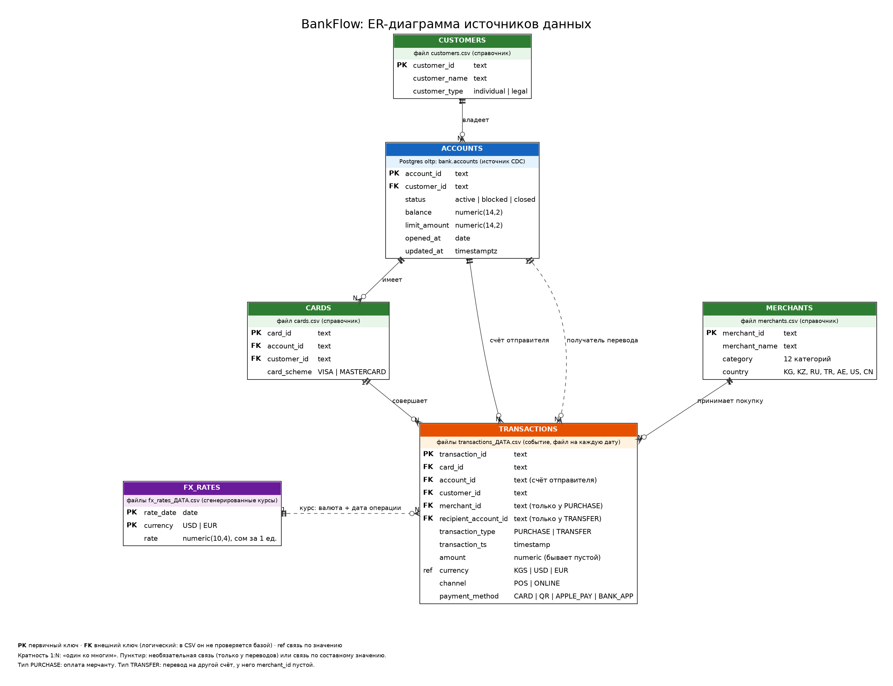
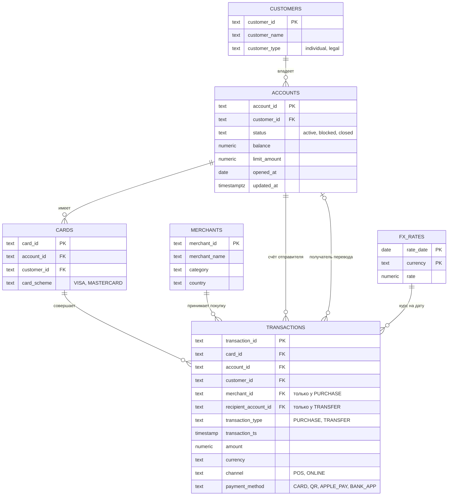

# ER-диаграмма источников BankFlow (ФТ-2)

Диаграмма ниже отображается прямо на GitHub (Mermaid). Картинка выше (`er_source.png`) та же самая, её удобно вставлять в слайды.

## Источники и зерно

| Сущность | Источник | Тип | Зерно (одна строка =) | Ключ |
|---|---|---|---|---|
| CUSTOMERS | `customers.csv` | справочник, файл целиком | один клиент (физлицо или юрлицо) | `customer_id` |
| ACCOUNTS | Postgres oltp, таблица `bank.accounts` | таблица, источник CDC | один счёт | `account_id` |
| CARDS | `cards.csv` | справочник, файл целиком | одна карта | `card_id` |
| MERCHANTS | `merchants.csv` | справочник, файл целиком | один мерчант | `merchant_id` |
| TRANSACTIONS | `transactions_ГГГГ-ММ-ДД.csv` | событие с датой, файл на каждую дату | одна операция (покупка или перевод) | `transaction_id` |
| FX_RATES | `fx_rates_ГГГГ-ММ-ДД.csv` | сгенерированные курсы, файл на каждую дату | валюта на дату | `rate_date` + `currency` |

## Связи и кратность

| Связь | Кратность | Ключ связи |
|---|---|---|
| клиент → счёт | 1:N | `customer_id` |
| счёт → карта | 1:N | `account_id` |
| карта → операция | 1:N | `card_id` |
| мерчант → операция (только покупки) | 1:N | `merchant_id` |
| счёт → операция как отправитель | 1:N | `account_id` |
| счёт → операция как получатель (только переводы) | 1:N, необязательная | `recipient_account_id` |
| курс → операция | 1:N | `currency` + дата из `transaction_ts` (связь по значению, составной ключ) |

## Два типа операций

| Тип | Что это | `merchant_id` | `recipient_account_id` | `payment_method` |
|---|---|---|---|---|
| `PURCHASE` | оплата мерчанту | заполнен | пустой | CARD, QR или APPLE_PAY |
| `TRANSFER` | перевод на другой счёт через банковское приложение | пустой | заполнен | BANK_APP |

Пустые значения в этих колонках для своего типа **нормальны**. Ошибкой считается пустой `merchant_id` у покупки или пустой `recipient_account_id` у перевода.

## Клиенты: физические и юридические лица

У юрлица траты и суммы больше, у него несколько счетов и карт, а в дни зарплаты (5-е и 20-е) оно переводит зарплату сотрудникам (зарплатная ведомость). У физлица есть доверенные получатели (родные, арендодатель), которым он переводит регулярно. Первый крупный перевод незнакомому получателю выглядит подозрительно, это основа антифрод-правил для переводов.

## Что важно знать про источник

- **Внешние ключи логические.** Источники это CSV-файлы, поэтому база не проверяет FK. Целостность связей мы проверяем сами на слоях ods и dds (ФТ-12).
- **Намеренная «грязь» в `transactions`** (около 1% строк): дубли `transaction_id`, пустой `merchant_id` у покупки, пустой `recipient_account_id` у перевода, пустая `amount`. Слой stg хранит их как есть, слой ods их убирает.
- **`customer_id` и `account_id` в операции** повторяют данные карты (денормализация источника, так бывает в выгрузках). У перевода `card_id` указывает карту-источник отправителя.
- **Типы** в колонках указаны целевые. В слое stg все колонки данных хранятся как `text`, типы появляются в ods.
- **Файл `ground_truth`** (правильные ответы для оценки антифрод-правил) не источник данных и на диаграмму не входит: пайплайн его не читает.
